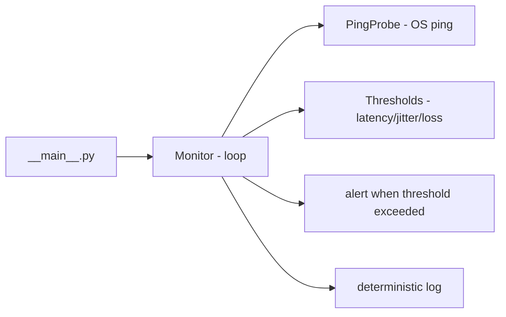

# monitor-qos-enlace

**English** · [Português (Brasil)](README.md)

[](#) [](#) [](#)

## What it is

A **link QoS monitor** in pure Python: it continuously pings a target (via the OS `ping` utility through `subprocess`), computes **latency, jitter and packet loss** per cycle, compares them with **configurable thresholds**, raises an **alert** when they are exceeded and writes a **deterministic log** (same input → same output). It is an educational network-monitoring lab.

## Status

An educational networking lab, working and tested (11 tests).

## Features

- **Ping probing via subprocess** (`probe.py`): runs the system `ping`; a `PingProbe` protocol makes it swappable for tests.
- **Continuous monitor** (`monitor.py`): measures latency, jitter and loss and raises an alert per cycle.
- **Configurable thresholds** (`Thresholds`): latency and jitter in ms, loss in %.
- **Deterministic log** (`log.py`): stable lines with status and alert.
- **CLI** `monitor-qos-enlace`: target, cycles, interval, count, log file and thresholds.

## Architecture

A `monitor_qos_enlace` package with `probe` (ping), `monitor` (measuring loop + alert), `log` (recording) and `__main__` (CLI). The probe is a protocol, so a deterministic fake can be injected in tests.



## Stack

- Python ≥ 3.10, stdlib only (subprocess, argparse)
- pytest (dev)

## Repository layout

```
monitor-qos-enlace/
├── pyproject.toml · BRIEF.md
├── src/monitor_qos_enlace/
│   ├── probe.py      # ping via subprocess (swappable protocol)
│   ├── monitor.py    # continuous measurement + alert
│   ├── log.py        # deterministic recording
│   └── __main__.py   # CLI
├── tests/test_monitor.py
└── LICENSE          # MIT
```

## Prerequisites and installation

Python ≥ 3.10. The OS `ping` utility must be available.

```bash
pip install -e .
```

## How to run

```bash
monitor-qos-enlace <target> [--ciclos N] [--intervalo S] [--contagem C] \
  [--log file.log] [--latencia-ms MAX] [--jitter-ms MAX] [--perda-pct MAX]
```

## Tests and quality

Real command (verified by the agent):

```bash
python -m pytest tests/
# 11 passed
```

There is no CI configured in this repository.

## Technical decisions and trade-offs

- **Real ping via subprocess** behind a swappable protocol: measures the actual network while staying testable with a deterministic fake.
- **Zero dependencies (stdlib)**: light and portable.
- **Deterministic log**: easy to compare and reprocess; in exchange, it does not capture non-deterministic variations.

## Known limitations and roadmap

- Depends on the OS `ping` (ICMP) — may need privileges on some systems.
- Basic metrics (latency/jitter/loss); no per-packet classification or route tracing.
- Text log only; no dashboard/chart.

## Development process

An individual project by Kelvin Oliveira, built with orchestrated AI agents and reviewed by the author. The monitor architecture and the review are the author's.

## License and author

MIT — Copyright (c) 2026 Kelvin Rebelo de Oliveira.

**Author**: [Kelvin Oliveira](https://github.com/KelvinOliveiraCode) · [Portfolio](https://kelvinoliveiracode.github.io/portfolio/)
