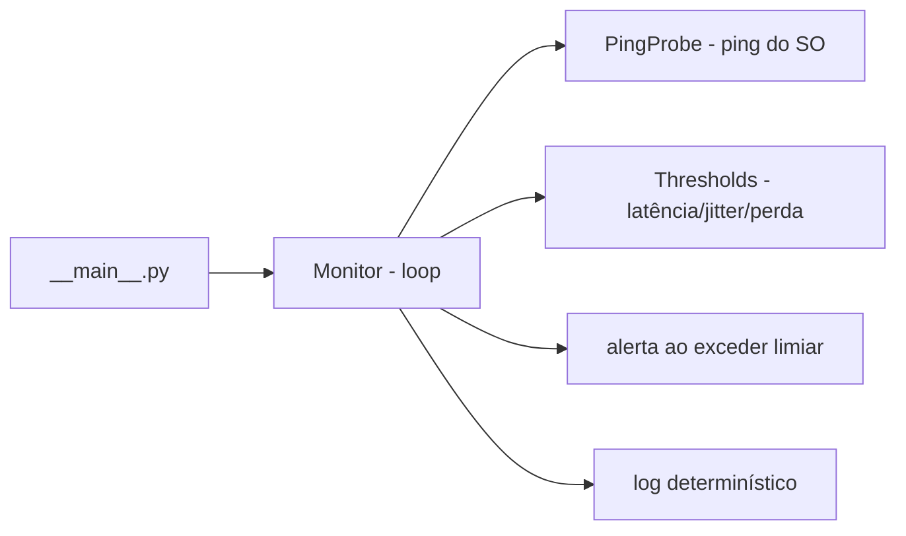

# monitor-qos-enlace

[English](README.en.md) · **Português (Brasil)**

[](#) [](#) [](LICENSE)

## O que é

**Monitor de QoS de enlace** em Python puro: faz **ping** contínuo num alvo (via utilitário `ping` do SO por `subprocess`), calcula **latência, jitter e perda de pacotes** a cada ciclo, compara com **limiares** configuráveis, **alerta** quando são excedidos e grava um **log determinístico** (mesma entrada → mesma saída). É um laboratório educacional de monitoramento de rede.

## Status

Laboratório educacional de rede, funcional e testado (11 testes).

## Funcionalidades

- **Sondagem de ping por subprocess** (`probe.py`): executa o `ping` do sistema; protocolo `PingProbe` substituível para testes.
- **Monitor contínuo** (`monitor.py`): mede latência, jitter e perda e emite alerta por ciclo.
- **Limiares configuráveis** (`Thresholds`): latência e jitter em ms, perda em %.
- **Log determinístico** (`log.py`): linhas estáveis, com status e alerta.
- **CLI** `monitor-qos-enlace`: alvo, ciclos, intervalo, contagem, arquivo de log e limiares.

## Arquitetura

Pacote `monitor_qos_enlace` com `probe` (ping), `monitor` (loop de medição + alerta), `log` (gravação) e `__main__` (CLI). O probe é um protocolo, então dá para injetar um fake determinístico em testes.



## Stack

- Python ≥ 3.10, stdlib apenas (subprocess, argparse)
- pytest (dev)

## Estrutura do repositório

```
monitor-qos-enlace/
├── pyproject.toml · BRIEF.md
├── src/monitor_qos_enlace/
│   ├── probe.py      # ping via subprocess (protocolo substituível)
│   ├── monitor.py    # medição contínua + alerta
│   ├── log.py        # gravação determinística
│   └── __main__.py   # CLI
├── tests/test_monitor.py
└── LICENSE          # MIT
```

## Pré-requisitos e instalação

Python ≥ 3.10. Ter o utilitário `ping` do SO disponível.

```bash
pip install -e .
```

## Como executar

```bash
monitor-qos-enlace <alvo> [--ciclos N] [--intervalo S] [--contagem C] \
  [--log arquivo.log] [--latencia-ms MAX] [--jitter-ms MAX] [--perda-pct MAX]
```

## Testes e qualidade

Comando real (verificado pelo agente):

```bash
python -m pytest tests/
# 11 passed
```

Não há CI configurado neste repositório.

## Decisões técnicas e trade-offs

- **Ping real via subprocess** com protocolo substituível: mede a rede de verdade, mas é testável com um fake determinístico.
- **Zero dependências (stdlib)**: leve e portável.
- **Log determinístico**: fácil de comparar/reprocessar; em troca, não captura variações não determinísticas.

## Limitações conhecidas e roadmap

- Depende do `ping` do SO (ICMP) — pode exigir privilégios em alguns sistemas.
- Métricas básicas (latência/jitter/perda); sem perda por pacote individual nem traçado de rota.
- Sem persistência além do log em texto; sem dashboard/gráfico.

## Processo de desenvolvimento

Projeto individual de Kelvin Oliveira, construído com agentes de IA orquestrados e revisado pelo autor. A arquitetura do monitor e a revisão são do autor.

## Licença e autor

MIT — Copyright (c) 2026 Kelvin Rebelo de Oliveira.

**Autor**: [Kelvin Oliveira](https://github.com/KelvinOliveiraCode) · [Portfólio](https://kelvinoliveiracode.github.io/portfolio/)
